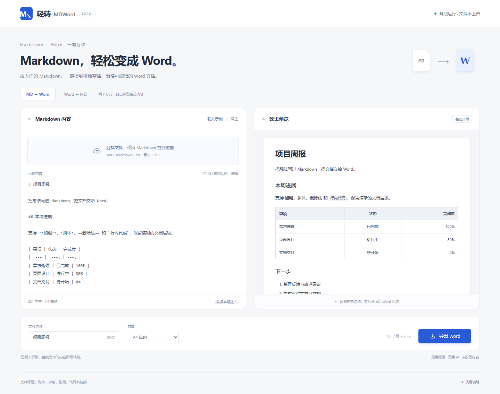
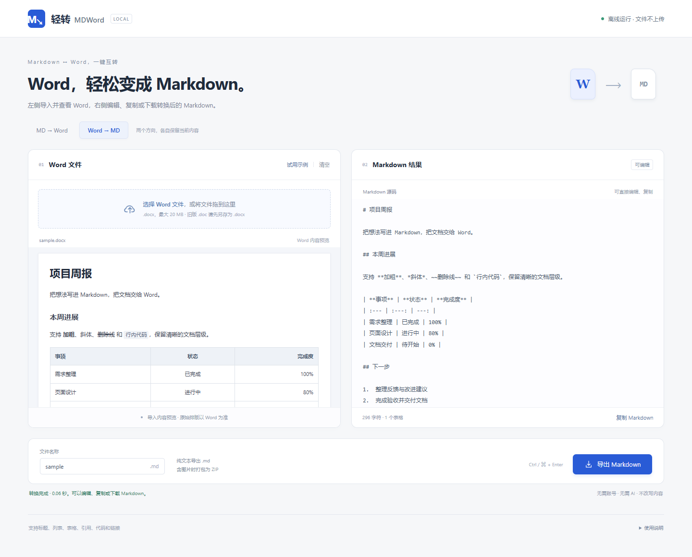

# 轻转 · MDWord

**Markdown ↔ Word，一键互转。**

轻转（MDWord）是一个简洁的本地文档转换工具。双击一个 HTML 文件，就能把 Markdown 转成排版整洁、表格可编辑的 Word，也能从 Word 中提取 Markdown 和图片。

无需 AI、账号或服务器，文件不上传。把时间留给写作，让格式转换在本地完成。



## 快速开始

1. 下载仓库中的 [轻转.html](./轻转.html)，或下载 Releases 中的离线版 ZIP 并解压。
2. 双击 `轻转.html`，使用现代桌面浏览器打开，推荐 Chrome 或 Edge。
3. 在页面顶部选择 **MD → Word** 或 **Word → MD**，导入文件后导出。

**只需一个 HTML 文件即可使用。** 所有转换依赖已打包在文件内，可以复制到其他电脑离线打开。日常使用不需要安装 Node.js、Word 或 LibreOffice。

> 从 GitHub 的文件页面下载时，点击 **Download raw file（下载原始文件）**。不要将 GitHub 的文件预览网页另存为 HTML。

## 功能

| 功能 | MD → Word | Word → MD |
| --- | --- | --- |
| 输入 | `.md`、`.markdown`、`.txt` 或粘贴文本 | 未加密的 `.docx` |
| 输出 | `.docx` | `.md`，含图片时输出 ZIP |
| 常见内容 | 标题、段落、强调、列表、引用、代码、链接 | 标题、段落、强调、列表、引用、常见代码字体、链接 |
| 表格 | 可编辑的 Word 原生表格，支持列对齐与跨页重复表头 | Markdown 表格，尽量保留列对齐与单元格换行 |
| 图片 | 手动添加本地 PNG、JPG、GIF、BMP | 提取嵌入图片，与 Markdown 一起打包 |
| 编辑与预览 | 左侧编辑 Markdown，右侧预览内容结构 | 左侧查看 Word 内容，右侧编辑或复制 Markdown 结果 |

两个方向各自保留本次页面中的草稿。切换方向不会覆盖另一边的内容；关闭或刷新页面后，草稿不会保存。

## Markdown 转 Word

1. 选择 **MD → Word**，拖入文件或粘贴 Markdown。
2. 如有本地图片，点击 **添加本地图片**，选择文中引用的图片文件。
3. 设置导出文件名。列较多的表格可选择 **A4 横向**。
4. 点击 **导出 Word**，在浏览器下载目录中查看 `.docx`。

支持六级标题、有序和无序列表、嵌套列表、任务清单、引用、分隔线、代码块及外部链接。表格带有浅色表头、灰色边框和自动换行；单元格内的 `<br>` 会转换为换行。

图片按文件名匹配，例如 `` 对应添加的 `demo.png`。同名图片请先改名以免冲突。远程图片不会自动下载，缺失图片会提示并在导出文档中保留文字说明。

## Word 转 Markdown

1. 选择 **Word → MD**，在左侧导入 `.docx`，查看文件名和文档内容预览。
2. 在右侧查看 Markdown 源码，可以直接编辑或点击 **复制 Markdown**。编辑结果不会改变左侧的导入内容预览。
3. 点击 **导出 Markdown**。包含图片时，点击 **导出 MD + 图片** 下载 ZIP。
4. 解压图片 ZIP 后，保持 `.md` 与 `images` 文件夹的相对位置。



左侧预览显示导入时提取的内容结构，原始字体、分页和复杂版式以 Word 文件为准。Word 表格的第一行会作为 Markdown 表头。单元格换行转换为 `<br>`；合并单元格展开为普通网格，内容放在左上位置，其余覆盖位置留空，并显示提示。嵌套表格会简化为文本。

## 文件与隐私

- 文件处理、预览和打包均在浏览器本地完成，无 AI 服务、CDN、外部字体或文档上传。
- 工具不将文档写入浏览器持久化存储；需要保留的内容请及时导出。
- 单次处理一个文件：Markdown 最大 **5 MB**，Word 最大 **20 MB**，手动添加的单张图片最大 **15 MB**。
- 支持 UTF-8 和带 BOM 的 UTF-16 文本；非 UTF-8 文本会尝试按 GB18030 读取并提示。
- 点击预览里的外部链接时，由浏览器打开对应网站。
- 快捷键：**Ctrl + Enter** 导出，macOS 使用 **⌘ + Enter**。

## 已知限制

轻转按规则转换内容结构，不润色、不改写文本，也不使用 AI 检查内容。不同文档格式之间仍可能存在信息损失：

- **Word 版式**：转为 Markdown 时不保留字体、页边距、分页、页眉页脚等页面设置。特殊编号、脚注、文档内链接和复杂列表可能被简化，请留意界面提示。
- **旧版和扫描件**：`.doc` 或加密文件需先用 Word / LibreOffice 另存为未加密的 `.docx`，直接改扩展名无效。扫描件不进行 OCR。
- **复杂对象**：Word 公式、图表、SmartArt 和嵌入对象可能无法提取。无法预览的图片格式会尽量作为附件保留。
- **Markdown 扩展**：公式、Mermaid、原始 HTML 等不做专门渲染；HTML 中只有 `<br>` 被识别为换行。不将 YAML 元数据、脚注或文档内目录解析成专门的 Word 结构。
- **表格和图片**：Markdown 标准表格不支持合并单元格；特别宽的表格建议选择横向或拆分。MD → Word 的 SVG 图片请先转为 PNG。
- **预览与分页**：预览展示内容结构，实际排版以文档阅读软件为准。系统字体差异也可能影响分页。

## 本地开发

使用 Node.js 22 或更新版本，以及 npm。首次安装依赖需要联网。

```bash
npm ci
npm run check
npm test
npm run build
```

构建后，根目录会生成完整的 `轻转.html`，无需开发服务器。

```text
src/
  index.html           页面模板
  styles.css           界面样式
  main.ts              文件导入、预览、模式切换与下载
  markdown.ts          Markdown 解析规则与示例
  converter.ts         Markdown → Word
  word-to-markdown.ts   Word → Markdown 与图片打包
scripts/
  build.mjs            生成离线 HTML 与第三方许可说明
  package.mjs          生成源码包和离线分发包
tests/                 转换、表格、图片与异常输入测试
docs/                  界面截图与简要使用说明
```

`npm test` 包含 18 项自动化测试，覆盖文档内容、表格结构、图片提取、ZIP 打包及异常输入。浏览器离线验证和导出文档检查记录见 [VALIDATION.md](./VALIDATION.md)。

## 打包与发布

```bash
npm run package
```

该命令先构建，再在 `release/` 生成两个文件：

- `qingzhuan-1.0.0-source.zip`：上传仓库用的源码包，包含源代码、测试、文档和构建好的 HTML。
- `qingzhuan-1.0.0-offline.zip`：供使用者下载的离线包，包含 `轻转.html`、使用说明和第三方许可说明。

发布前请运行 `npm run check` 和 `npm test`。包名中的版本号随 `package.json` 更新。依赖目录、缓存、本机安装脚本及测试临时文件不包含在发布包中。

仓库简介、建议 Topics 和上传步骤见 [GITHUB.md](./GITHUB.md)。

## 技术与第三方许可

- [markdown-it](https://github.com/markdown-it/markdown-it)：解析 Markdown。
- [docx](https://github.com/dolanmiu/docx)：生成 Word 文档。
- [Mammoth](https://github.com/mwilliamson/mammoth.js)：提取 DOCX 内容。
- [Turndown](https://github.com/mixmark-io/turndown)：生成 Markdown。
- [JSZip](https://github.com/Stuk/jszip)：读取文档容器和打包图片。

完整第三方许可见 [THIRD_PARTY_NOTICES.txt](./THIRD_PARTY_NOTICES.txt)，构建时也会嵌入独立 HTML。项目自身尚未指定许可证，第三方许可不替代项目自身的授权。
